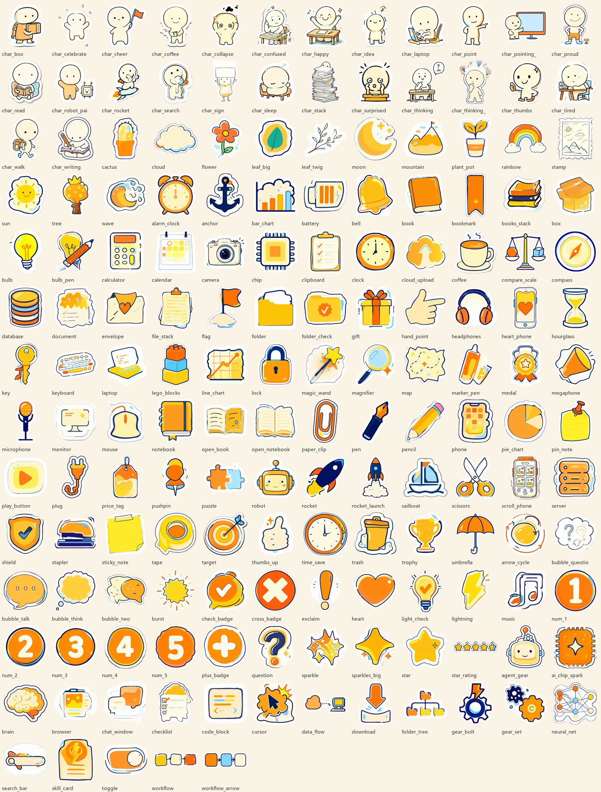

# 1 nook-xhspage

把一份已经定好内容的小红书图文方案（一个 JSON 文件），渲染成一套 3:4 手账涂鸦风图片：封面加内页，1242×1656。文字、版式、图示都是代码画的，字准、可改；贴纸来自随库附带的 161 个透明 PNG 素材库，**不需要 ComfyUI，也不需要任何图片生成接口**。

只负责"画"。文案、提纲、标题和正文由配套的 [nook-xhswrite](../nook-xhswrite/README.md) 完成，两者之间的接口就是这份方案 JSON。


上图每一行是同一份内容换一套风格：薄荷（mint）、手账（paper）、深色（dark）、船票（ticket）。第一行薄荷是通用款，自带虚拟 IP 人物，谁拿到都能直接用。

## 1.1 它解决什么问题

让能力一般的 agent（Codex、Antigravity、Trae、OpenCode 等）也能稳定做出小红书图文，靠的是词表、字段规格和脚本检查，不靠模型临场发挥：

- 页型、风格、贴纸都是封闭词表，不存在的 id 直接报错并列出可选项。
- 每个字段有字数上限，放不下就报错让你改文案，不会悄悄缩字。
- 图上出现的数字、日期必须能在方案的事实清单里找到，找不到就拒绝出图。
- 去 AI 味的表面表达（15 类）在校验时就被拦下。
- 出图后再查一遍：文字溢出、留白、贴纸压住文字。

## 1.2 要求

- Python 3.10 以上。
- Pillow、numpy、playwright 和 Chromium。Windows 下双击 `setup.bat` 一键安装，其他系统：

```bash
pip install -r requirements.txt
python -m playwright install chromium
```

- 字体（思源黑体、霞鹜文楷）已随库附带，许可见 `assets/fonts/LICENSE-fonts.txt`（SIL OFL）。

## 1.3 快速开始

在 `scripts/` 目录里运行：

```bash
python xhs.py selftest                     # 自检，确认环境可用（词表、素材、示例、检查、出图）
python xhs.py setup --default              # 第一次使用必须设置品牌：通用款（薄荷），一条命令，见第 4 节
python xhs.py list-types                   # 列出 22 个页型、字段和字数上限
python xhs.py render ../examples/demo_mint_reading.json --out ./out
```

做自己的图文：把方案 JSON 放进一个工作文件夹，然后

```bash
python xhs.py validate plan.json           # 只校验，不出图
python xhs.py preview plan.json --page 1   # 只出一页看效果
python xhs.py render plan.json             # 全量出图，并拼出 overview.png
python xhs.py deliver plan.json post.md    # 交付：方案校验、正文检查、出图，三项都过才算完成
```

不想用命令行：`python xhs.py ui` 打开本机网页界面（浏览器访问 http://127.0.0.1:8770）。

方案 JSON 的写法见 [references/schema.md](references/schema.md)，示例在 `examples/`。退出码：0 通过，1 校验失败，2 出图时发现版面问题，3 品牌未设置。

## 1.4 品牌设置（第一次必须做）

没有设置品牌时，`validate`、`render`、`preview` 会拒绝执行并退出（退出码 3），先问清楚这几件事，再运行一次 `setup`：

1. 有没有自己的 IP 人物形象（透明底 PNG，最好抱臂、讲解、邀请三个姿态）？没有也可以不用人物。
2. 有没有自己的 Logo（浅底和深底各一张）？没有也可以不用。
3. 账号名叫什么？画在封面左上角的小标签。
4. 默认用哪种视觉风格？

```bash
python xhs.py setup --name "账号名" --pose-a 人物.png --logo-light 浅底.png --logo-dark 深底.png
python xhs.py setup --name "账号名" --no-person --no-logo
python xhs.py setup --default              # 用随库附带的通用款（IP 人物薄荷 + 薄荷风格），可直接正式使用
python xhs.py setup --default --name "你的账号名"   # 通用款，只把左上角的账号名换成自己的
python xhs.py setup --captain              # 作者本人的船长款
```

设置存在用户目录 `~/.nook-xhspage/`，skill 目录里不放任何个人信息。通用款的人物「薄荷」是本库自生成的虚拟形象，可以直接当自己的账号形象用，也可以用 `setup` 换成自己的人物和 Logo。`--captain` 是作者本人的形象，只用于复现作者的样片。

## 1.5 四套风格

同一份页面代码，只换底色和材质，每套的文字对比度都经过自检（`check-themes`）。

| 风格 | 气质 | 适合 |
|---|---|---|
| mint 薄荷 | 薄荷白底，墨绿蓝字，珊瑚红强调，自带插画底图和虚拟人物 | 通用款，任何账号、任何题材，默认 |
| paper 手账 | 奶油纸底，暖色手绘 | 观点、清单、入门类 |
| dark 深色 | 暖灰褐底，奶油字，不刺眼 | 工具、技术、Agent 类 |
| ticket 船票 | 蓝白，每页是一张船票，底部票根印账号名和条码 | 作者品牌款，别人不必用 |


薄荷风格配了一套同色系的贴纸（`assets/library/mint/`，49 个，涂鸦小人、灯泡、火箭、放大镜等常用款），方案里照常写原来的素材 id，渲染时自动换成薄荷配色版。下面是用它做的一篇 9 页示例（`examples/demo_mint_reading.json`）：


## 1.6 22 个页型

封面 3：`cover_list`、`cover_person`、`cover_quote`。内页 17：`step`（真实截图加红框箭头）、`prompt`、`idea`、`quote`、`list`、`toc`、`compare`、`result`、`timeline`、`stats`、`shots`，图示 `cycle`、`matrix`、`pyramid`、`funnel`、`bar`、`line`。结尾 2：`closing`、`back_cover`。

规则：3 到 9 页；第 1 页是封面类；相邻两页页型不同；一篇至少 3 种页型；页面不画页码。封底和结尾页不放二维码、联系方式、导流话术。


## 1.7 素材库

`assets/library/` 里有 161 个透明 PNG 贴纸，分角色、物件、自然、图标、装饰五类，统一白色模切边、藏青线稿、橙黄奶油填充，`manifest.json` 是索引。agent 只按 id 引用。贴纸不是必须的，是否放按七步判断（页型有没有贴纸位、页面是否已满、内容是否严肃等），`suggest-assets` 逐页给结论。



## 1.8 检查项

| 检查 | 命令 | 说明 |
|---|---|---|
| 字段、字数、素材 id、截图位置 | `validate` | 截图和成果图必须放在方案旁边的 `inputs/` |
| 去 AI 味 | `validate`、`lint-text` | 15 类表面表达，另有夸大承诺、绝对化的提醒 |
| 事实核对 | `validate` | 数字和日期必须在 `meta.facts` 里，不能写“真相”“内幕”这类定论词 |
| 关卡文件 | `render` | `facts.md`、`outline.md`、`needs.md`、`covers.md` 和方案放在同一文件夹，缺一个不出图 |
| 版面 | `render` | 文字溢出、留白、贴纸压字 |
| 正文包 | `check-post` | 3 个标题、5 到 8 个标签、正文 400 到 800 字、删除测试记录 |
| 主题对比度 | `check-themes` | 四套风格的文字和底色对比 |

放在 skill 自带目录里的示例方案只做提醒级检查，`deliver` 不接受它们。

## 1.9 目录

| 位置 | 内容 |
|---|---|
| `SKILL.md` | 给 agent 的说明，含 1.6、1.8 两节硬规则 |
| `scripts/` | `xhs.py` 命令入口、`spec.py` 页型和规格、`render.py` 渲染、`factcheck.py` `lint.py` `post.py` 检查、`selftest.py` 自检 |
| `assets/` | `fonts/` 字体、`brand/mint/` 通用款品牌、`brand/default/` 船长款、`themes/mint/` 薄荷底图、`library/` 贴纸素材库、`examples/` 示例截图 |
| `examples/` | 各风格示例方案、正文包示例、反例 |
| `references/` | `schema.md` 接口、`acceptance.md` 验收、`publish-checklist.md` 发布前检查 |
| `docs/` | 本 README 的配图 |

## 1.10 已知限制

- 字数上限和留白上限是估计值，需要在真实使用里校准。
- 素材库里文档、文件堆、搜索框、标签、笔记本电脑几个条目偏糊。
- 手写字用的是随库附带的霞鹜文楷，不是真正的手写体。
- 脚本只能查数字和日期，没有数字的编造（比如“旗舰都换了两轮”）查不出来，发布前仍要人工通读。
- “工具类用深色、观点类用浅色”只是建议，没有数据验证。
- 在 Windows 上开发和测试，其他系统和干净机器的安装没有验证过。

## 1.11 许可

代码和素材库随本仓库许可。字体各自的许可见 `assets/fonts/LICENSE-fonts.txt`。默认品牌的人物和 Logo 见第 4 节说明。
