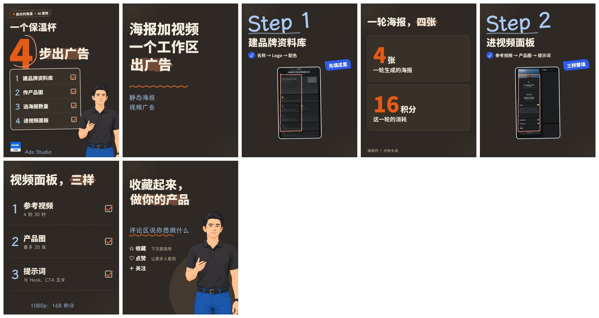

# nook-xhswrite

小红书图文的内容层：把粗糙素材（文章、逐字稿、新闻、一句话念头）提炼成事实清单、提纲、封面候选，写出能交给 [nook-xhspage](../nook-xhspage/README.md) 渲染的方案 JSON，并写图文下方的标题、标签和正文。

它不画图，不发布，不采集。画图交给 `nook-xhspage`。



## 1 为什么要分关卡

能力一般的 agent 容易直接把素材压成一篇看起来完整的稿，顺手编出日期、数字和结论。这个 skill 把流程拆成几个关卡，每个关卡输出一个固定格式的文件，**写完就停下，等用户确认**：

| 关卡 | 输出文件 | 做什么 |
|---|---|---|
| 0 品牌设置 | 无 | 只在第一次：问有没有自己的人物、Logo、账号名、默认风格 |
| 1 事实清单 | `facts.md` | 每条事实带素材原句和位置，猜测单独标“推测”，加一句话核心 |
| 2 提纲 | `outline.md` | 选框架、逐页页型和一句话、事实来源、风格和贴纸建议 |
| 3 素材需求 | `needs.md` | 需要用户提供哪些截图和成果图；图片只由用户提供，agent 不找、不用占位图 |
| 4 封面候选 | `covers.md` | 2 到 3 个封面，出预览，用户挑 |
| 5 方案和正文 | `plan.json`、`post.md` | 写方案，写标题 3 选 1、标签、正文、删除测试记录，`deliver` 通过才算完成 |

## 2 怎么用

用户只需要一句话：

```text
用 nook-xhswrite 把这篇做成小红书图文：<素材文件路径>
```

agent 没有注册这个 skill 时，补一句路径：

```text
先读 <skills 目录>/nook-xhswrite/SKILL.md，再按它做。素材：<素材文件路径>
```

工作文件夹默认建在素材旁边，叫 `xhs_<期号或主要词>/`，所有关卡文件和方案都放在里面。更多提示词见 [references/agent-prompt.md](references/agent-prompt.md)。

## 3 内容原则

- **事实只来自素材。** 素材没给的数字、日期、因果不写。素材里的“可能”“说不定”，图上也要带这个语气。
- **提炼框架，不压缩字数。** 图里只放标题、框架、事实、数据、流程，长文写进正文。
- **封面加第 2 页必须说清：这是什么、给谁、得到什么。** 悬念留给正文。
- **放不下就缩短原文，不换内容。**
- **发布全人工。** 不放二维码、联系方式和导流话术。

## 4 12 个内容框架

步骤流程、并列清单、前后对比、问题原因做法、是什么为什么怎么做、层级体系、循环迭代、筛选漏斗、取舍矩阵、数据变化、指令模板、误区对照。每个框架有一份可校验的方案示例，在 `references/plans/`。

## 5 目录

| 位置 | 内容 |
|---|---|
| `SKILL.md` | 给 agent 的说明：关卡、事实边界、贴纸判断、正文规则、人工自检清单 |
| `references/frameworks.md` | 12 个框架的选择表、页序和页型 |
| `references/templates.md` | 关卡 1 到 5 的输出模板 |
| `references/hooks.md` | 封面钩子、标题写法 |
| `references/extract.md` | 长素材怎么抽事实 |
| `references/plans/` | 12 份可校验的方案示例 |
| `references/agent-prompt.md` | 给 agent 的提示词 |
| `docs/` | 本 README 的配图 |

## 6 已知限制

- 弱模型仍可能写出素材里没有的、不带数字的句子，发布前需要人工通读图和正文。
- 目前只在 OpenCode（GLM-5.3-flash）和 Claude 上跑通过，其他 agent 没有验证。
- 去 AI 味只查表面表达，“没有锚点”“节奏太顺”靠人工自检清单。
